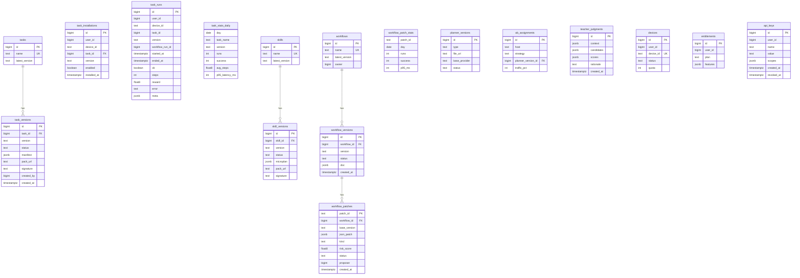

下面给你三份完整文档：**开发者手册**、**运维手册**、**工作流作者指南**。最后附上**ER 图（Mermaid）**与**OpenAPI/Swagger 3.0** 规范。

---

# 开发者手册（Developer Handbook）

## 1. 架构与分层

* **LLM 层**：Planner（AgentQ+MCTS）、Reflexion、RAG 召回、离线 DPO/RLAIF。
* **语义指令层**：`instr.*`（12–14 个统一动作）。
* **编译层**：Target 解析与回退（`element_id/css/xpath/role+text/bbox_var` → `ext.*` 或 `coords.*`）。
* **执行层**

  * Web：Chrome 扩展 + CDP（`ext.open_url/click_selector/type_text/...`）
  * 桌面：pyautogui（`click_coordinates/wheel_coordinates/...`）+ `anchor.*` + 本地 OCR。
* **编排层**：Workflow（状态机 + 条件/循环）、Macro、Task（可复用“积木”）。
* **平台层**：任务/宏市场、计费授权、API Key 管理、SQS 队列、可观测/审计、AutoFix & Auto Promote。

## 2. 代码结构（建议）

```
/extensions/chrome/            # Web 执行器
/runtime/
  engine/                      # 执行引擎与编译器
    compiler.py                # instr → ext/coords 映射
    executor_web.py            # ext.* 适配
    executor_desktop.py        # coords.*/anchor.*/ocr.*
    variables.py               # ctx.vars / save / 参数绑定
    transitions.py             # 条件与循环
  actions/                     # 动作注册（register_action）
    instr_*.py                 # instr.click/type_text/...
    task_run.py                # task.run
    macro_run.py               # macro.run
    data_vars.py               # set_variable/increment_variable/...
    queue_sqs.py               # queue.publish/consume_once
  planner/
    agentq.py                  # 候选生成
    mcts.py                    # 搜索与模拟
    reflexion.py               # 自我反思
    recall.py                  # RAG 轨迹召回
  ocr/
    paddle_ocr.py              # 本地 OCR 适配
    anchor.py                  # 模板/文字锚点
/tools/wam/                    # Workflow Authoring Module（Builder/Validator/Simulator/AutoFix）
/server/
  api/                         # Express/FastAPI 路由
  services/                    # S3/SQS/签名/Schema 校验
  models/                      # Postgres 访问
  migrations/                  # SQL 迁移
/ui/console/                   # 控制台（任务/工作流/补丁/灰度）
```

## 3. 动作体系

* **对外（LLM/作者）**：`instr.*`（click/type\_text/select\_option/scroll/navigate/history/hover/key/upload/read/wait/task\_complete/answer\_user/annotate?）。
* **内部原语**：`ext.*`（CDP）、`coords.*`（pyautogui）、`anchor.*`、`ocr.*`、变量/循环动作、队列 I/O。
* **注册方式**

```python
# runtime/engine/registry.py
ACTION_REGISTRY = {}
def register_action(name):
    def deco(fn): ACTION_REGISTRY[name]=fn; return fn
    return deco
```

* **新增动作准则**

  * 语义对外尽量复用 `instr.*`；新原语用插件形式注入。
  * 所有动作必须：参数校验→安全边界（host/window）→审计日志→幂等可选。

## 4. 编译与回退策略

* 目标解析顺序：`element_id → css → xpath → role+text → bbox_var`。
* DOM 首选 `ext.*`，失败自动尝试：

  1. `ext.wait_quiet` 后重试；
  2. `ext.scroll` 微调后重试；
  3. 回退到 `bbox_var` → `click_coordinates`。
* 桌面默认 `bbox_var`/锚点，限制在目标窗口内（`window_bounds`）。

## 5. Task（积木）与 Macro（技能）

* **Task manifest**：`inputs/outputs/preconditions/postconditions/policy(retries,idempotency,max_runtime)/impl(macro|steps)`。
* **API**：`/tasks/publish|promote|rollback|install|list|stats`，客户端仅走 API，不直连 DB。
* **晋升**：staging→stable→locked；失败一键回滚。
* **Planner 优先**：召回 Task Catalog → 生成 `task.run` 动作。

## 6. AutoFix & Auto Promote

* 运行期失败 → AutoFix 仅在会话内注入“安全补丁”（`wait_quiet_insert/scroll_then_retry/...`）。
* 补丁以 JSON Patch 存档；满足阈值后按灰度策略**自动晋升**为新版本（或人工采纳）。
* 开关与阈值参照“补充文档”的 `autofix` 区块。

## 7. 测试与模拟

* **WAM**：`WF().for_range()/poll()` 快速搭建循环/轮询骨架；`validate()` + `simulate()` 强约束。
* 单测：动作参数校验/安全边界/变量替换；编译器选择与回退路径。
* 集成：`publish→install→task.run→stats`；SQS 消费者；OCR/anchor 资源加载。
* E2E：真实站点/桌面 20+ 回合，观察成功率/延迟/日志证据。

## 8. 安全

* 客户端不直连 Postgres。
* Host/Window 边界强校验；上传需显式授权（CDP）。
* 全局急停；动作速率与“人类化”微抖动。
* API Key 支持明文可见或加密存储（租户策略决定）。

---

# 运维手册（Ops Handbook）

## 1. 部署拓扑

* **服务端**：API（Node/FastAPI）+ Postgres + 对象存储（S3/MinIO）+ SQS（生产）/LocalStack（本地）。
* **客户端**：Python 运行器 + Chrome 扩展 + OCR/锚点资源。
* **网络**：客户端仅 HTTPS 调用 API；S3/SQS 走 VPC Endpoint（生产）。

## 2. 环境变量（示例）

```
PG_URL=postgres://...
S3_BUCKET=automation-artifacts
S3_REGION=...
SQS_URL=https://sqs....
JWT_PUBLIC_KEY=...
AUTOFIX_DEFAULT_MODE=suggest_only
AUTOFIX_PROMOTE_ENABLED=false
# ... 详见补充文档 §4
```

## 3. 数据与备份

* **数据库**：每日全量 + 15 分钟增量；保留 7–30 天。
* **对象存储**：任务/宏包与截图/证据，生命周期策略（30–90 天）。
* **密钥**：KMS/Hashicorp Vault；密钥轮换 90 天。

## 4. 监控指标

* 业务：Task 成功率、p95、LLM 成本、AutoFix 触发率、自动晋升成功率。
* 基础：API p99、错误率、队列积压、DB 连接、磁盘与对象存储失败比。
* 告警阈值：队列滞留 > 5 分钟、Task 成功率日内下降 > 10%、AutoFix 连续失败 > N。

## 5. 队列（SQS）

* 队列：`hp-reply`（高优）、`lp-ingest`（低优）、DLQ。
* 可见性超时/重试：HP 小、LP 稍大；DLQ 触发报警。
* 本地：LocalStack 映射，测试时保证名称一致。

## 6. 灰度与回滚

* Planner/Macro/Task/Workflow 均支持版本化与灰度。
* 回滚：控制台/CLI 一键；数据库与对象存储元数据同步回退。

## 7. 安全运维

* API Key 明文模式仅开放给特定租户（合规审批）；默认加密。
* 客户端权限：Win（管理员）、macOS（辅助功能）操作说明模板。
* 行为审计：所有执行事件、补丁、晋升与回滚均入审计表；保留期 ≥ 180 天。

## 8. 常见故障 Runbook

* **无法点击/频繁超时**：检查 `ext.wait_quiet` 是否按站点增大；建议开启 AutoFix。
* **桌面误点**：确认 `window_bounds` 与 DPI；开启窗口限定与人类化。
* **LLM 成本飙升**：Planner 限流、优先 Task；夜间 DPO，Teacher 打分限配额。
* **SQS 积压**：临时扩容消费者；HP 队列优先级抢占。

---

# 工作流作者指南（Author Guide）

> 你已经看过一版，这里是**最终整合版**（含 AutoFix 配置）。

## 1. 写作黄金法则

1. **能用 Task 就用 Task**；其次 Macro；最后 `instr.*`。
2. **目标语义化**：优先 `role+text`/稳定 CSS；桌面用 `bbox_var` + 锚点。
3. **等待优先**：`wait_quiet`/`instr.wait` 替代长 `sleep_ms`。
4. **循环有止**：计数器或“底部锚点”；必要时加最大轮次与异常回退。
5. **异步优先级**：HP（回复）优先，LP（巡检）次之。
6. **安全边界**：host/window 限定；上传需授权；急停按键。

## 2. 工作流骨架

```json
{
  "version": "1.3",
  "start": "loop",
  "autofix": {
    "mode": "suggest_only"   // 可选：auto_promote_on_success，详见补充文档
  },
  "vars": { "i": 0 },
  "states": {
    "loop": {
      "actions": [
        { "do":"task.run", "name":"indeed.apply_current", "args":{"i":"@i"} },
        { "do":"increment_variable", "name":"i" }
      ],
      "transitions": [
        { "if":"@i < 10", "go_to":"loop" },
        { "else_go_to":"done" }
      ]
    }
  }
}
```

## 3. 常用片段

* **读取保存**

```json
{ "do":"instr.read", "target":{"css":"div.comment-pane"}, "fields":["texts"], "save":"comments" }
```

* **桌面微信发消息（Task）**

```json
{ "do":"task.run", "name":"wechat.send_message", "args":{"user_anchor":"@contact","text":"你好"} }
```

* **无限下拉 + 哨兵**

```json
{
  "actions":[
    { "do":"instr.scroll","dir":"down","amount":800,"target":{"css":"div.comment-pane"} },
    { "do":"anchor.find","template":"end_marker","region":"@comment_pane_bbox","save":"end" }
  ],
  "transitions":[
    { "if":"@end != null", "go_to":"extract" },
    { "else_go_to":"self" }
  ]
}
```

## 4. AutoFix 配置（可选）

```json
"autofix": {
  "mode": "auto_promote_on_success",
  "promote": {
    "enabled": true,
    "threshold": { "successes": 20, "window": 50, "min_runs": 30, "p95_latency_ms": 8000 }
  },
  "allowed_patch_kinds": ["wait_quiet_insert","scroll_then_retry","selector_role_text"],
  "risk_gate": { "disallow_host_widening": true }
}
```

## 5. 调试与校验

* 本地：`wam.validate`（Schema+语义）→ `wam.simulate`（可达性、循环收敛）→ 小流量灰度。
* 生产前：截图与事件日志打开；AB 实验保守上线；保留回滚计划。

---

# ER 图（Mermaid）



---

# OpenAPI / Swagger 3.0（精简但可跑）

```yaml
openapi: 3.0.3
info:
  title: YOLO+LLM Automation API
  version: "1.0.0"
servers:
  - url: https://api.yourdomain.com
security:
  - bearerAuth: []
components:
  securitySchemes:
    bearerAuth:
      type: http
      scheme: bearer
  schemas:
    TaskManifest:
      type: object
      required: [name, version, impl]
      properties:
        name: { type: string }
        version: { type: string }
        title: { type: string }
        description: { type: string }
        inputs: { type: object, additionalProperties: true }
        outputs: { type: object, additionalProperties: true }
        preconditions: { type: array, items: { type: string } }
        postconditions: { type: array, items: { type: string } }
        policy:
          type: object
          properties:
            retries: { type: integer, default: 0 }
            retry_backoff_ms: { type: integer, default: 400 }
            idempotency_key: { type: string }
            max_runtime_ms: { type: integer, default: 15000 }
        impl:
          type: object
          oneOf:
            - properties:
                macro: { type: string }
                args: { type: object, additionalProperties: true }
              required: [macro]
            - properties:
                steps:
                  type: array
                  items:
                    type: object
                    properties:
                      do: { type: string }
                      target: { type: object, additionalProperties: true }
                      text: { type: string }
                      key: { type: string }
                      url: { type: string }
                      value: {}
                      ms: { type: integer }
                      save: { type: string }
                    required: [do]
              required: [steps]
    WorkflowDoc:
      type: object
      required: [start, states]
      properties:
        version: { type: string }
        start: { type: string }
        vars: { type: object, additionalProperties: true }
        autofix:
          type: object
          properties:
            mode:
              type: string
              enum: [suggest_only, hot_patch_session, auto_promote_on_success]
            promote:
              type: object
              properties:
                enabled: { type: boolean, default: false }
                strategy: { type: string, default: auto_promote_on_success }
                threshold:
                  type: object
                  properties:
                    successes: { type: integer, default: 20 }
                    window: { type: integer, default: 50 }
                    min_runs: { type: integer, default: 30 }
                    max_error_rate: { type: number, default: 0.05 }
                    p95_latency_ms: { type: integer, default: 8000 }
                rollout:
                  type: object
                  properties:
                    staging_percent: { type: integer, default: 20 }
                    soak_minutes: { type: integer, default: 120 }
                cooldown_minutes: { type: integer, default: 30 }
            limits:
              type: object
              properties:
                max_patches_per_run: { type: integer, default: 2 }
                max_total_patches_per_day: { type: integer, default: 10 }
            allowed_patch_kinds:
              type: array
              items:
                type: string
                enum: [wait_quiet_insert, scroll_then_retry, selector_role_text, dom_to_coords_fallback, timeout_increase_small]
            risk_gate:
              type: object
              properties:
                max_dom_change_ratio: { type: number, default: 0.2 }
                disallow_host_widening: { type: boolean, default: true }
                disallow_upload_semantics_change: { type: boolean, default: true }
        states:
          type: object
          additionalProperties:
            type: object
            required: [actions]
            properties:
              actions:
                type: array
                items: { type: object, additionalProperties: true }
              transitions:
                type: array
                items:
                  type: object
                  properties:
                    if: { type: string }
                    go_to: { type: string }
                    else_go_to: { type: string }
              on_success: { type: string }
paths:
  /tasks/publish:
    post:
      summary: Publish a task pack (.taskpack.tgz)
      requestBody:
        required: true
        content:
          multipart/form-data:
            schema:
              type: object
              properties:
                file:
                  type: string
                  format: binary
      responses:
        '200':
          description: Published
          content:
            application/json:
              schema:
                type: object
                properties:
                  task_id: { type: integer }
                  name: { type: string }
                  version: { type: string }
                  status: { type: string }
  /tasks/promote:
    post:
      summary: Promote a task version to stable
      requestBody:
        required: true
        content:
          application/json:
            schema:
              type: object
              required: [name, version]
              properties:
                name: { type: string }
                version: { type: string }
      responses:
        '200': { description: OK }
  /tasks/rollback:
    post:
      summary: Rollback a task to previous stable
      requestBody:
        required: true
        content:
          application/json:
            schema:
              type: object
              required: [name]
              properties:
                name: { type: string }
      responses:
        '200': { description: OK }
  /tasks/list:
    get:
      summary: List available tasks
      parameters:
        - in: query
          name: host
          schema: { type: string }
        - in: query
          name: app
          schema: { type: string }
      responses:
        '200':
          description: Task list
          content:
            application/json:
              schema:
                type: array
                items:
                  type: object
                  properties: { name: {type:string}, latest_version: {type:string}, status: {type:string} }
  /tasks/install:
    post:
      summary: Install a task version for a device
      requestBody:
        required: true
        content:
          application/json:
            schema:
              type: object
              required: [device_id, name, version]
              properties:
                device_id: { type: string }
                name: { type: string }
                version: { type: string }
      responses:
        '200': { description: OK }
  /task/run:
    post:
      summary: Record a task run (or proxy trigger)
      requestBody:
        required: true
        content:
          application/json:
            schema:
              type: object
              properties:
                name: { type: string }
                version: { type: string }
                ok: { type: boolean }
                steps: { type: integer }
                error: { type: string }
                meta: { type: object }
      responses:
        '200': { description: OK }
  /workflows/settings/autofix:
    post:
      summary: Set AutoFix config for a workflow
      requestBody:
        required: true
        content:
          application/json:
            schema:
              type: object
              required: [workflow_id, autofix]
              properties:
                workflow_id: { type: integer }
                autofix: { $ref: '#/components/schemas/WorkflowDoc/properties/autofix' }
      responses:
        '200': { description: OK }
  /workflows/patches/propose:
    post:
      summary: Propose a patch (system or manual)
      requestBody:
        required: true
        content:
          application/json:
            schema:
              type: object
              required: [workflow_id, base_version, json_patch, kind]
              properties:
                workflow_id: { type: integer }
                base_version: { type: string }
                json_patch: { type: array, items: { type: object } }
                kind: { type: string }
      responses:
        '200': { description: OK }
  /workflows/patches/list:
    get:
      summary: List patches of a workflow
      parameters:
        - in: query
          name: workflow_id
          schema: { type: integer }
      responses:
        '200':
          description: Patch list
          content:
            application/json:
              schema:
                type: array
                items: { type: object }
  /workflows/promote:
    post:
      summary: Promote workflow new version (apply patch)
      requestBody:
        required: true
        content:
          application/json:
            schema:
              type: object
              required: [workflow_id, base_version, json_patch]
              properties:
                workflow_id: { type: integer }
                base_version: { type: string }
                json_patch: { type: array, items: { type: object } }
                rollout:
                  type: object
                  properties:
                    staging_percent: { type: integer }
                    soak_minutes: { type: integer }
      responses:
        '200': { description: OK }
  /workflows/rollback:
    post:
      summary: Rollback workflow to previous stable
      requestBody:
        required: true
        content:
          application/json:
            schema:
              type: object
              required: [workflow_id]
              properties:
                workflow_id: { type: integer }
      responses:
        '200': { description: OK }
```

---